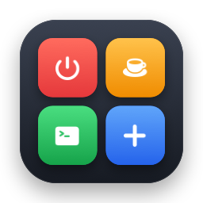
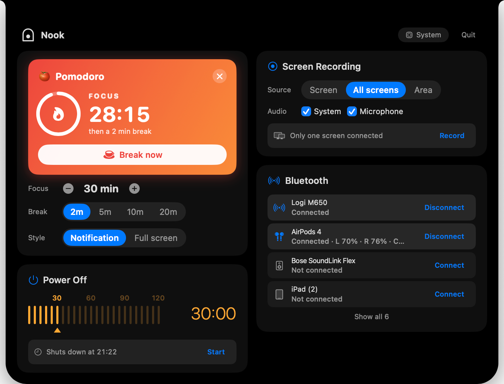
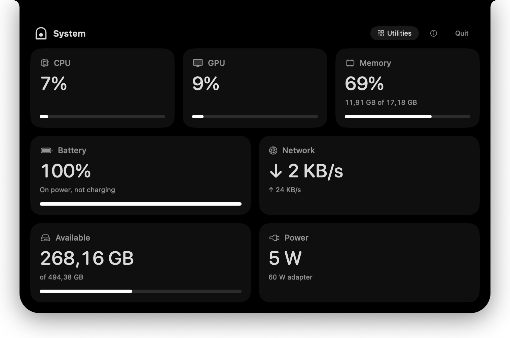
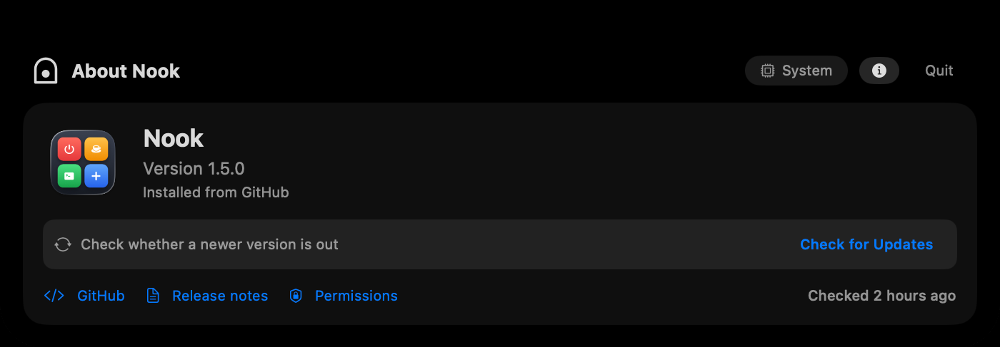

<p align="center"></p>

<h1 align="center">Nook</h1>

<p align="center"><strong>Your little corner of utilities, right under the notch.</strong></p>

<p align="center">
  <a href="https://github.com/cs-tungthanh/nook/releases/latest"></a>
  
  
  <a href="https://cs-tungthanh.github.io/projects/nook/"></a>
</p>

Nook lives in your menu bar. Click its icon and a panel drops down from the notch, like the Dynamic Island, with a Pomodoro timer, a shutdown timer, background music, screen recording, your Bluetooth devices and your Mac's vitals. Click away or press Esc and it folds back up.

<p align="center">
  
</p>

## Install

```bash
brew install --cask cs-tungthanh/tap/nook
```

Nook updates itself: when a new version is out, the island shows **Update to x.y.z**, and **About › Update & Relaunch** installs it. You can also run `brew upgrade --cask cs-tungthanh/tap/nook`, and remove Nook with `brew uninstall --cask cs-tungthanh/tap/nook`.

> [!NOTE]
> Use the full name `cs-tungthanh/tap/nook`. A plain `brew install nook` installs a different app, a web browser that's also called Nook.

Nook needs an Apple silicon Mac with macOS 13 or later; screen recording needs macOS 15. It isn't notarized by Apple, so the Homebrew cask clears the download's quarantine flag for you. To build it yourself instead, see [Build from source](#build-from-source).

## What's inside

| | |
|---|---|
| ⏱️ **Pomodoro** | Focus sprints of 20, 25, 50 minutes or your own length, with a live countdown ring, then a break as a notification or a full-screen overlay. Pauses while your Mac is locked or asleep. |
| ⏻ **Power Off** | Drag along a ruler to shut your Mac down in 5 minutes to 2 hours. Cancel in one click. |
| 🎵 **Music** | Study, sleep, focus and jazz live streams from YouTube on a card with the video's artwork. Search YouTube, play your own playlists, autoplay related videos, and pick the music back up once your Mac goes quiet. |
| ⏺️ **Screen Recording** | One screen, all screens or an area, with system audio and your microphone. Pause, resume and save as `.mov`. |
| 📶 **Bluetooth** | Your paired devices with battery levels, including AirPods left, right and case. Connect or disconnect in one click. |
| 📊 **System** | CPU, GPU, memory, battery, network, disk space and power draw at a glance. |
| 🔐 **Permissions** | Every macOS permission Nook uses, whether it's allowed, and a button to allow it or open System Settings. |
| ℹ️ **About & updates** | Your version, how Nook was installed, and one-click updates from GitHub. |

<p align="center">
  
</p>

<p align="center">
  
</p>

## Features in detail

<details>
<summary><strong>Pomodoro</strong></summary>

- A colorful card in the island: press **Start focusing**, then watch the countdown ring: tomato red while you focus, mint green on a break, grey while paused.
- If macOS has notifications turned off for Nook, the tile says so, since Notification-style breaks would pass unseen, and **Permissions** takes you to the fix.
- Focus for 20, 25 or 50 minutes, then break for 2, 5 or 10, or pick **Custom** and set your own with − and +. Changing the focus length keeps the time you've already focused.
- **Break now** starts a break early, **Snooze 5m** pushes the next one back, and **Back to focus** ends a break.
- Two break styles: a **Notification** with Start break, Snooze and Skip actions, or a **Full screen** blurred overlay with a countdown. Press Esc to get back to focus; the screen is never locked.
- Pauses while your Mac is locked or asleep and picks up where it stopped. A ☕ icon shows in the menu bar during a break.

</details>

<details>
<summary><strong>Power Off</strong></summary>

- Click or drag along the ruler to pick 5 minutes to 2 hours in 5-minute steps, then press **Start**.
- Shutting down needs Nook to control System Events (Automation). The first **Start** asks for it, closing the island so the macOS prompt shows; without it nothing is scheduled, and the tile says so with a **Permissions** button.
- A live countdown in the island and a power icon in the menu bar while a shutdown is scheduled. Cancel with one click.
- You get a notification when a shutdown is scheduled or cancelled, and if macOS refuses to shut down, Nook tells you why.

</details>

<details>
<summary><strong>Music</strong></summary>

- The Music tile is a colored card with the artwork of what's playing, a ☆ to save it as a station, and the seek bar along its bottom.
- Pick a station: **Study**, **Sleep**, **Focus** or **Jazz**. Each plays a current live stream, so it never goes stale.
- Press 🔍 to search YouTube. Filter by **Live**, **Playlists** or **Long (1h+)**, choose with ↑↓ and press Return to play, or ⌘Return to also save it as a station. Your last 10 searches stay listed.
- When a video or playlist ends with nothing after it, Nook plays a related video next, like YouTube's autoplay, and ⏩ does the same on a single video. Turn it off with **Autoplay Related Videos** in the station menu. Live stations don't autoplay.
- **Resume when quiet**, in the Music tile or the station menu, starts the music again once your Mac has made no sound for 1 or 5 minutes, or a delay you choose, so pausing for a call or a video doesn't end it for the day. It plays the last station, or Study if you haven't played one, and waits while your Mac is locked or asleep. It's off by default.
- Before you type, search shows **Recommended**: videos YouTube lists alongside the last few you played in Nook, leaving out ones you've already played or saved.
- Save search results with **☆ Save**, or **Add from YouTube Link…**. **Recently Played** lists the last 15 stations.
- Switching stations fades the old music out. If something can't play outside YouTube, Nook says so and goes back to what was playing.
- Music keeps playing with the island closed, with a ♪ icon in the menu bar. Right-click the menu bar icon to play, pause or switch stations.
- Click anywhere on the seek bar to jump to that moment, drag to scrub, or press ↺10 / ↻10 to go back or forward 10 seconds. Live streams don't show the bar.
- Press ↗ to open what's playing on youtube.com at the same moment; Nook pauses so the two don't overlap.
- **Connect YouTube Account** adds your Liked videos and playlists, private ones included. Each playlist opens a list of its videos: choose **Play All**, or pick a video to start the playlist from there. Sign-in happens in your browser, Nook only reads your account, and the sign-in is kept in your Keychain.
- Videos play through YouTube's own player, so YouTube's ads may play too.

</details>

<details>
<summary><strong>Screen Recording</strong></summary>

- **Source**: one **Screen**, **All screens** side by side in one video, or an **Area** you drag out after pressing Record (Esc cancels).
- Include **System** audio, your **Microphone**, or both.
- **Stop** pauses the recording. Then **Resume**, **Save** to name the `.mov` and pick a folder, or **Discard**. Quitting with an unsaved recording asks where to save it first.
- A red **Stop** button with the elapsed time sits in the menu bar while recording. Nook's own island is left out of the video.
- Very wide videos, such as two Retina screens, are saved as HEVC and scaled to what the encoder supports.

</details>

<details>
<summary><strong>Bluetooth</strong></summary>

- Each device shows whether it's connected and its battery level, including left, right and case for AirPods.
- **Connect** or **Disconnect** with one click. The first four devices are shown; **Show all** lists the rest.
- To forget a device, use **System Settings › Bluetooth**; macOS doesn't let other apps unpair devices.

</details>

<details>
<summary><strong>System</strong></summary>

- **CPU**, **GPU** and **Memory** usage, each with a meter that turns orange above 85%.
- **Battery** level and charging state, **Network** download and upload speed, **Available** disk space, and **Power**: the watts your Mac draws and the adapter's rating.
- Updates every 1.5 seconds, and only while the page is open.

</details>

<details>
<summary><strong>About & updates</strong></summary>

- Click ⓘ in the island's header to see your version, whether Nook was installed with Homebrew, and links to GitHub and the release notes.
- Nook checks GitHub for a new release shortly after launch and every 6 hours, and sends one notification per new version.
- **Update & Relaunch** downloads the release, checks it against the SHA-256 that GitHub publishes, installs it (through Homebrew when Nook came from there) and reopens Nook. Each step is logged to `~/Library/Logs/Nook/update.log`.

</details>

<details>
<summary><strong>Permissions</strong></summary>

- Open it from **About › Permissions**, or from the **Permissions** button a tile shows when it's missing access.
- Each permission shows **Allowed**, **Not allowed** or **Not asked yet**. **Allow** brings up the macOS prompt; **Settings** opens the right pane of System Settings.
- Screen Recording shows only **Allowed** or **Not allowed**, since macOS doesn't say whether it has asked. Its **Settings** also adds Nook to the list there, which can bring up the macOS prompt the first time.
- Automation shows **Unknown** when System Events isn't running, since macOS can only answer for a running app. **Check** starts it and reads the status again.
- The page re-reads every status every 2 seconds while it's open, so a change made in System Settings shows up on its own. Screen Recording is the exception: macOS applies it after you quit and reopen Nook.

</details>

### Permissions

macOS asks for each of these the first time Nook needs it, and **About › Permissions** shows where each one stands:

| Permission | Why |
|---|---|
| **Notifications** | Break reminders, shutdown alerts and update notices |
| **Automation** (System Events) | Shutting down your Mac at the scheduled time |
| **Bluetooth** | Listing, connecting and disconnecting your devices |
| **Screen & System Audio Recording**, **Microphone** | Only when you record your screen |

## Build from source

You need macOS 13 or later, the Swift compiler (Xcode or the Command Line Tools) and, for the command-line tools, Go.

```bash
make build        # compile, bundle and sign Nook.app
make install      # build, replace /Applications/Nook.app and launch it
make hooks        # once per clone: block commits that hold a secret or home path
```

Run `make` to list every target. `make uninstall` quits and removes Nook, and `make run` builds and opens the repo copy. The targets call `scripts/build.sh` and `scripts/install.sh`, which you can also run directly. Local builds take the latest release's version number, so the update check treats them as current.

`scripts/build.sh` signs with your Apple Development or Developer ID certificate when you have one, so macOS keeps Nook's permissions across rebuilds; otherwise it signs ad-hoc. Set `NOOK_SIGN_IDENTITY` to choose an identity, or `-` to force ad-hoc.

<details>
<summary><strong>Connect YouTube: set up a Google client ID</strong></summary>

Listing your own playlists needs a Google OAuth client ID built into Nook. Without one, Nook works as usual but doesn't offer **Connect YouTube Account**.

1. In [Google Cloud Console](https://console.cloud.google.com/), create a project and enable **YouTube Data API v3**.
2. Set up the OAuth consent screen (External), add the `youtube.readonly` scope, and add your Google account as a test user.
3. Create an **OAuth client ID** of type **iOS** with bundle ID `com.nook.app`.
4. Put it in a `.env` file at the repo root (it's gitignored), then run `make install`:

   ```
   NOOK_YOUTUBE_CLIENT_ID=1234567890-abc.apps.googleusercontent.com
   ```

While the Google project is in testing, Google signs you out after 7 days and Nook offers to connect again. YouTube no longer gives apps your watch history, so **Recently Played** only covers what played in Nook.

</details>

<details>
<summary><strong>Command-line tools</strong></summary>

Two standalone Go tools live in `tools/`, separate from the app. Pass their flags through `ARGS`:

```bash
# Remove duplicate commands from ~/.zsh_history, keeping the latest of each
# (multi-line commands stay whole; a backup is saved as .zsh_history.bak)
make clean-zsh [ARGS="path/to/history"]

# Preview which Microsoft Edge bookmarks have moved, then save them with -apply
make bookmarks [ARGS="-apply -wait 3 -bookmarks path -edge path -proxy url"]
```

Or run them directly with `cd tools && go run ./clean-zsh` and `go run ./edge-bookmarks`.

Close Edge completely before running the bookmark updater with `-apply`, because Edge can overwrite its bookmarks file when it quits.

The updater checks links in a fresh, signed-out Edge profile, so it doesn't use Edge's built-in VPN. If your network blocks a site, pass `-proxy` to go through a proxy or VPN, for example `-proxy socks5://127.0.0.1:1080`. Supported schemes are `http`, `https`, `socks4` and `socks5`, without a username or password.

</details>

<details>
<summary><strong>Releasing</strong></summary>

Push a version tag:

```bash
git tag -a v1.2.0 -m "Nook 1.2.0" && git push origin v1.2.0
```

The [Release workflow](.github/workflows/release.yml) builds Nook with that version, attaches `Nook-1.2.0.zip` to a GitHub release, and updates `Casks/nook.rb` in [cs-tungthanh/homebrew-tap](https://github.com/cs-tungthanh/homebrew-tap) from the template in `packaging/homebrew/nook.rb`. Installed copies of Nook then offer the update.

| Secret | Required | What it is |
|---|---|---|
| `HOMEBREW_TAP_TOKEN` | Yes | A fine-grained token with **Contents: read and write** on `homebrew-tap` |
| `NOOK_YOUTUBE_CLIENT_ID` | No | The Google OAuth client ID; without it, releases don't offer **Connect YouTube Account** |
| `MACOS_CERT_P12` | No | Your signing certificate exported as `.p12`, base64-encoded |
| `MACOS_CERT_PASSWORD` | No | The `.p12` export password |

Without a certificate, releases are signed ad-hoc and macOS forgets Nook's Screen Recording and Microphone permissions after every upgrade. A Developer ID certificate works, and so does a free self-signed one (Keychain Access → Certificate Assistant → Create a Certificate…, type **Code Signing**). Either way, keep the same certificate for every release; the build log shows "Signing with identity …" when it's used.

</details>

<details>
<summary><strong>Project layout</strong></summary>

| Path | What it is |
|---|---|
| `Sources/Nook/App/` | The app's entry point, app delegate (menu bar menus) and shared constants |
| `Sources/Nook/Features/` | One file or folder per feature: Pomodoro, ScreenRecorder, Bluetooth, Music, Permissions, SystemMonitor, Updater, Notifier |
| `Sources/Nook/UI/` | SwiftUI views: the island, its pages (`ContentView`, one extension per page), shared components, button styles and themes |
| `Sources/Nook/Support/` | Small helpers used across features |
| `Info.plist` | App bundle settings |
| `icon/` | App icon and the script that draws it (`make icon`) |
| `scripts/build.sh` | Compiles, bundles and signs `Nook.app` |
| `scripts/install.sh` | Builds and reinstalls Nook in `/Applications` (`--uninstall` removes it) |
| `packaging/homebrew/` | Template for the Homebrew cask |
| `.github/workflows/release.yml` | Builds a release and updates the Homebrew tap when a `v*` tag is pushed |
| `.githooks/pre-commit`, `.gitleaks.toml` | Blocks commits that hold a secret or a home path (enable with `git config core.hooksPath .githooks`) |
| `Makefile` | Entry points for the scripts and tools (run `make` to list them) |
| `screenshots/` | Images of the island used in this README |
| `tools/` | Standalone Go tools, not part of the app: `clean-zsh` (Zsh history cleaner) and `edge-bookmarks` (Edge bookmark updater) |

</details>


Ideas and contributions are welcome: [open an issue](https://github.com/cs-tungthanh/nook/issues).

## License

Nook is released under the [MIT License](LICENSE).

<p align="center"><sub>Made for the little things that make your day easier.</sub></p>
