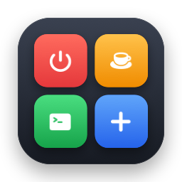

<p align="center"></p>

# Nook

**Your little corner of utilities.**

Nook is a lightweight macOS app that brings everyday utilities together in one convenient place. From managing breaks to scheduling shutdowns and cleaning up your system, Nook helps you take care of small tasks without interrupting your workflow.

## ✨ Features

Nook lives in your menu bar. Click the grid icon to open it.

- **Power-off Timer** — Schedule your Mac to shut down after a set time.
  - One-click presets: 30min, 40min or 1h, or enter any number of minutes.
  - A live countdown in the menu bar (e.g. `1h30m`) and in the popup.
  - Cancel with one click. You get a notification when a shutdown is scheduled or cancelled.
- **Break Timer** — Remind yourself to take regular breaks and step away from your screen.
  - A reminder every N minutes (20 by default), with breaks of 10m, 30m, 1h or 2h.
  - Two styles: a **Notification** with Start break / Snooze / Skip actions, or a **Full screen** blurred overlay with a countdown (press Esc to skip; the screen is never locked).
  - A ☕ countdown in the menu bar during a break.
  - Pauses while your Mac is locked or asleep. Settings are remembered between launches.
- **Cleanup** — Command-line tools that keep your system tidy (not in the menu bar app yet):
  - `clean-zsh` removes duplicate commands from `~/.zsh_history`, keeping the latest of each.
  - The bookmark updater follows redirects in your Microsoft Edge bookmarks and rewrites links that have moved.
- **More Utilities** — A growing collection of handy tools for everyday tasks.

> Features are planned to evolve as Nook grows.

## 🎯 Philosophy

Nook is built around a few simple principles:

- **Simple** — Do one thing well, without unnecessary complexity.
- **Lightweight** — Stay out of your way and use resources responsibly.
- **Convenient** — Keep useful tools within easy reach.
- **Native** — Feel at home on macOS, with an interface that is clean and familiar.
- **Extensible** — Make it easy to add new utilities as needs evolve.

## 🖥️ Platform

- macOS

## 🚀 Getting Started

### Requirements

- macOS 13 (Ventura) or later
- Swift compiler (comes with Xcode or the Command Line Tools)
- Go, for the command-line tools

### Build and run the app

```bash
./build.sh
open Nook.app
```

To install it, copy it to your Applications folder:

```bash
cp -r Nook.app /Applications/
```

On first use, macOS asks for two permissions:

- **Automation** — to shut down your Mac at the scheduled time.
- **Notifications** — for shutdown alerts and break reminders.

### Command-line tools

```bash
# Remove duplicate commands from ~/.zsh_history (a backup is saved as .zsh_history.bak)
go run ./clean-zsh [path/to/history]

# Preview which Edge bookmark URLs have moved, then save them with -apply
go run . [-apply] [-wait 3] [-bookmarks path] [-edge path]
```

Close Edge completely before running the bookmark updater with `-apply`, because Edge can overwrite its bookmarks file when it quits.

### Project layout

| Path | What it is |
|---|---|
| `Nook.swift` | The menu bar app (SwiftUI + AppKit) |
| `Info.plist` | App bundle settings |
| `build.sh` | Compiles, bundles and signs `Nook.app` |
| `icon/` | App icon and the script that draws it (`swift icon/make-icon.swift`) |
| `clean-zsh/` | Zsh history cleaner |
| `main.go` | Edge bookmark updater |

## 🛣️ Roadmap

- [x] Build the core app interface
- [x] Implement the break timer
- [x] Add scheduled power-off functionality
- [ ] Bring the cleanup utilities into the app
- [x] Add a menu bar interface for quick access
- [ ] Support configurable preferences
- [ ] Expand the collection of utilities over time

## 🤝 Contributing

Nook is a work in progress. Ideas, suggestions, and contributions are welcome.

## 📄 License

The license has not been decided yet.

---

Made for the little things that make your day easier.

**Nook** — Your little corner of utilities.
